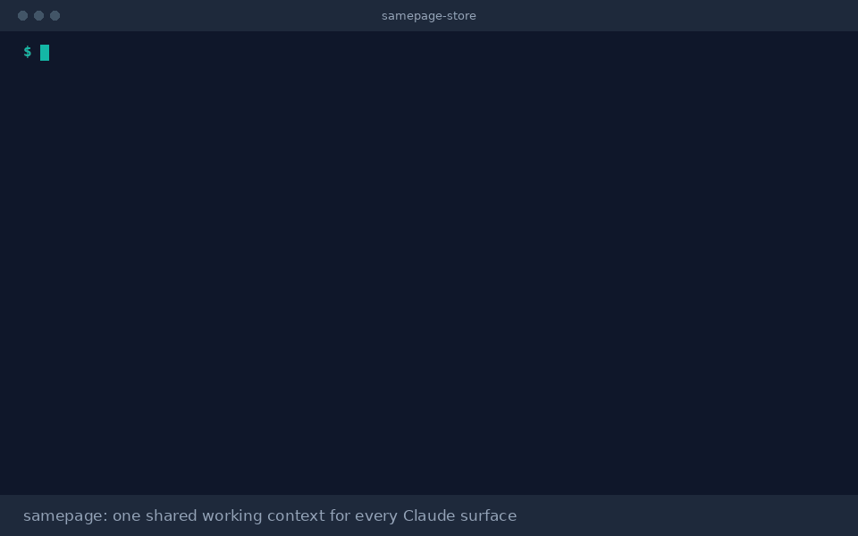

<p align="center">
  <picture>
    <source media="(prefers-color-scheme: dark)" srcset="docs/brand/samepage-mark-white.svg">
    
  </picture>
</p>

<h1 align="center">samepage</h1>

<p align="center"><b>Your AI tools forget. samepage doesn't.</b><br>
One shared working context for Claude, Codex, Gemini CLI, Copilot, Cursor and Windsurf, in a private repo you own.</p>

<p align="center"></p>

---

You plan in claude.ai chat, build in Claude Code, design in Claude Design and run long tasks in Cowork. Each one starts from zero. Chat doesn't know what you shipped in Code yesterday. Code reopens a decision you settled in chat last week. You paste the same brief into three tabs.

samepage gives all of them one shared working context, stored in a private repo you own:

| | What it holds | What changes |
|---|---|---|
| **Projects** | Status, stack, links, outcomes | Every session knows what you're working on |
| **Decisions** | Settled choices and the reason | No surface reopens a closed question |
| **Ships** | What shipped, when, with links and metrics | Any surface can answer "what did we get done?" |
| **Handoffs** | A brief left on one surface for another | Plan in chat, build in Code, report back |
| **Rules** | How you want Claude to work, everywhere or per surface | Say it once, every surface follows it |
| **Design** | Where each design system's tokens live | Claude Design and Claude Code use the same tokens |
| **You** | Name, role, links | Claude writes as you, not as a stranger |

## Who it's for

Anyone who works on the same projects across more than one Claude surface.

| You are | What you get |
|---|---|
| A developer | Code starts every session knowing the stack, the open work and the decisions already made |
| A founder | One place for what shipped this week, ready for an investor update or a changelog |
| A product manager | Specs planned in chat handed to Code as briefs, with the decisions behind them |
| A designer | Design system pointers that Claude Design and Claude Code both follow |
| A consultant or freelancer | Shipped work with real links, for proposals and case studies |
| Anyone with a review coming | A dated record of what you delivered, instead of reconstructing it from memory |

If you only chat with Claude and don't run ongoing projects, claude.ai's built-in memory is enough. samepage is for work that moves between surfaces.

No hosted server. No API keys. No account to create. Your store is a private GitHub repo of plain Markdown files.

## How it works

```
 claude.ai chat / Cowork                 Claude Code                      Claude Design
 ───────────────────────                 ───────────                      ─────────────
 samepage skill reads one file           plugin hook boots your context   links your product repo and
 through the GitHub connector;           into every session, matched to   uses the same design tokens
 "log this" writes an entry              the project you're in; /sp log
                                         writes an entry
            \                                   |                                 /
             \______________________  your private store  _______________________/
                                  (private GitHub repo of Markdown)
```

Every write is a small, typed entry you confirm first. A tiny index of pre-built "boot files" keeps reads to one file per session, under 2,000 tokens.

## Works with

samepage is built for Claude first. Other coding tools connect through a local MCP server and an instruction file, so they read and write the same store.

| Tool | How it connects | Status |
|---|---|---|
| Claude Code | Plugin: context loads at session start, `/sp` commands | Tested |
| claude.ai chat | Skill plus the GitHub connector | Community-tested |
| Cowork | Skill plus the GitHub connector | Community-tested |
| Claude Desktop | Local MCP server (`sp setup claude-desktop`) | Community-tested |
| Claude Design | Reads your product repo's tokens; no install | Community-tested |
| Gemini CLI | Local MCP server and GEMINI.md (`sp setup gemini`) | Community-tested |
| Codex | Local MCP server and AGENTS.md (`sp setup codex`) | Community-tested |
| GitHub Copilot | Local MCP server and copilot-instructions.md (`sp setup copilot`) | Community-tested |
| Cursor | Local MCP server and a project rule (`sp setup cursor`) | Community-tested |
| Windsurf | Local MCP server and a project rule (`sp setup windsurf`) | Community-tested |

Tested means a full run (boot, a confirmed write, a handoff picked up) passed and is recorded in the [tool ledger](docs/build/tool-ledger.md). Community-tested means it is built and covered by tests but no maintainer run has passed yet. If you run it, open an issue with what happened. ChatGPT is not supported in v1.

## Set up

Pick the path that matches how you use Claude. Both end at the same private store, so you can add the other path later. No Notion needed.

### I use Claude Code

1. In Claude Code: `/plugin install samepage --marketplace rx4u/samepage`
2. Run `/sp init`. It asks your name, headline and up to three working rules, then creates a private `samepage-store` repo.
   No GitHub CLI? It gives you the one-click link below instead and connects the repo you create.
3. Start a new session. Your context loads on its own; say "log this" after you ship something.

### I only use claude.ai chat or Cowork

1. **Create your store:** [one click](https://github.com/new?template_owner=rx4u&template_name=samepage-store-template&name=samepage-store&visibility=private). Keep the name `samepage-store` and keep it Private, then click Create repository.
2. **Add the skill:** download [samepage.skill](https://github.com/rx4u/samepage/raw/main/dist/samepage.skill). In claude.ai go to Customize, Skills, +, Upload a skill, and choose the file. Skills need code execution on (Settings, Capabilities). Turn on the GitHub connector with access to your store repo.
3. **Say "set up samepage".** Claude finds `samepage-store`, asks who you are, and writes your profile after your yes.

Saving from chat needs one GitHub permission: the Claude GitHub app installed on your account with access to the store repo (GitHub settings, Applications). Until then chat reads everything and hands you each entry to paste on GitHub. Claude walks you through it.

### I use another coding tool (Codex, Gemini CLI, Copilot, Cursor, Windsurf, Claude Desktop)

1. Install the `sp` command (needs `git` and `python3`, no sudo):

   ```bash
   git clone https://github.com/rx4u/samepage "$HOME/.samepage/tool" && sh "$HOME/.samepage/tool/install.sh"
   ```

2. Create or connect your store: `sp init` (or `sp init --use-existing you/samepage-store`).
3. From inside a project, connect your tool: `sp setup codex` (or `gemini`, `copilot`, `cursor`, `windsurf`, `claude-desktop`). It adds a `samepage` entry to the tool's MCP config, keeping a `.samepage-backup` copy of the old file, and writes a short instruction file to the project. That file holds no store content, so it is safe to commit. Add `--dry-run` to see every change first.
4. Restart the tool and ask "what am I working on?". Writes show a preview and wait for your yes.

Cursor and Windsurf config paths are not verified yet, so for those `sp setup` prints the snippet to paste instead of editing the file. Gemini CLI runs MCP servers only in folders you trust.

### Claude Design

Link your product repo when you start a design. Put your tokens in `design/tokens.json` (W3C design token format), and log the design system once ("log the design system for halcyon") so every surface knows where it lives.

### Requirements

- Claude Code and other coding tools: `git` and `python3` 3.9 or newer (macOS asks to install the command line tools the first time). Linux and macOS; Windows is untested.
- claude.ai path: nothing to install.

## Use it

| Say or run | What happens |
|---|---|
| "what am I working on?" | Your active projects, rules and open handoffs, from one read |
| `/sp log` or "log this" after shipping | Drafts a ship event from your session, shows it, writes it after your yes |
| "what did I ship this month?" or "what have I shipped with Next.js?" | Up to 20 shipped projects with outcomes and links, newest first |
| "hand this to Code" | Leaves a brief that your next Claude Code session shows at start |
| "log decision: Supabase over Firebase because of RLS" | Recorded with its reason; superseded decisions are kept, not deleted |
| `/sp brief halcyon` | A design brief to paste into Claude Design, naming your tokens file |

## Works with native memory

claude.ai memory remembers personal facts and preferences inside chat. samepage holds working context that has to travel to every surface and stay structured: projects, shipped work with proof, decisions, design pointers and handoffs. Use both.

## Your data

- Your store is private and yours: a repo you own (or a Notion page, if you choose Notion). samepage never runs a hosted server and never sees your data. The MCP server for other tools runs on your own machine.
- Nothing is written without your confirmation. Nothing is deleted: projects are archived, decisions superseded.
- `sp check` blocks secrets (API keys, tokens, private keys, card numbers) from ever entering a store.
- Store content is treated as data. Instructions found inside entries are never followed.

## Prefer Notion?

samepage can keep the store in Notion databases instead of GitHub. It is slower and limited by Notion's query allowance, so GitHub is the default. With the skill installed and the Notion connector on, say "set up samepage in Notion". See [notion-template](notion-template/README.md).

## Store format

Plain Markdown with flat frontmatter, one entry per file. See [SPEC.md](SPEC.md). Check any store with `python3 -m sp check path/to/store`.

## Status

Built in public. The full architecture, decisions and build plan are in [docs/architecture](docs/architecture/README.md).

## License

MIT
