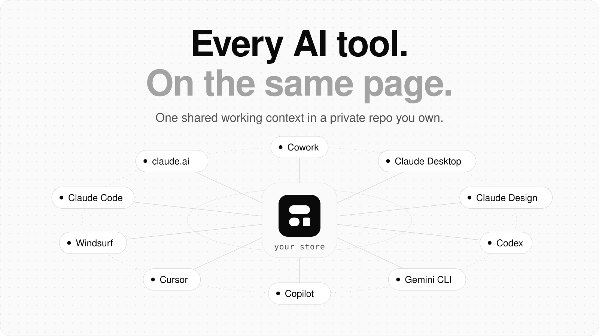
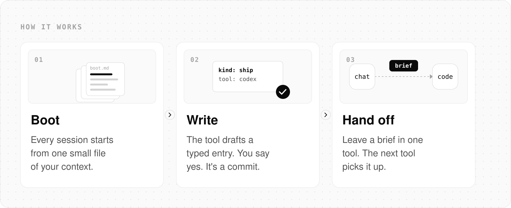
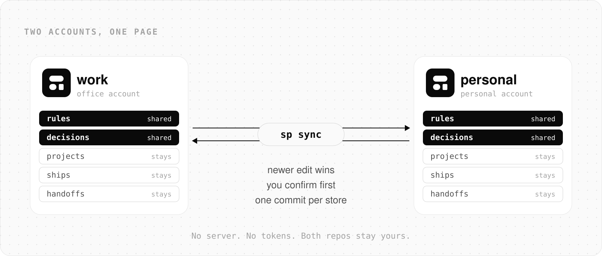

<p align="center">
  <a href="https://samepage-sigma.vercel.app">
    <picture>
      <source media="(prefers-color-scheme: dark)" srcset="docs/readme/hero-dark.svg">
      
    </picture>
  </a>
</p>

<p align="center">
  <a href="https://samepage-sigma.vercel.app"><b>Website</b></a> &nbsp;·&nbsp;
  <a href="#set-up"><b>Set up in one line</b></a> &nbsp;·&nbsp;
  <a href="https://github.com/rx4u/samepage/releases/latest"><b>Latest release</b></a> &nbsp;·&nbsp;
  <a href="SPEC.md"><b>Store format</b></a>
</p>

<p align="center"><a href="https://m8ven.ai/mcp/rx4u-samepage-1o2njd?s=readme"></a></p>

<p align="center"><b>Your AI tools forget. samepage doesn't.</b><br>
One shared working context for Claude, Codex, Gemini CLI, Copilot, Cursor and Windsurf, in a private repo you own.<br>
No server. No API keys. No account to create.</p>

---

## Set up

One line, in a terminal on Mac or Linux. It asks nothing.

```bash
curl -fsSL https://samepage-sigma.vercel.app/install | sh
```

It installs the `sp` command in `~/.samepage` (no sudo), makes your private store, and connects every AI tool it finds on the machine: Claude Code (the plugin, plus a session-start entry in your Claude Code settings so context loads by itself), Codex, Gemini CLI, Copilot, Cursor, Windsurf and Claude Desktop (a local MCP server). Then open any of them and ask "what am I working on?".

- **Store:** if the GitHub CLI is signed in, your store is a private `samepage-store` repo (an existing one is connected, never overwritten). If not, the store stays on this machine, and running the line again after `gh auth login` puts it on GitHub.
- **Profile:** your name comes from GitHub or git, with the headline "Building with AI tools". Edit `profile.md` in your store to change either.
- **Safe to run again:** it reuses your store and updates the plugin. Every config file it edits keeps a `.samepage-backup` copy.
- **Read it first:** the script is [install.sh](install.sh). To see every step without writing anything, run `curl -fsSL https://samepage-sigma.vercel.app/install | SAMEPAGE_NO_START=1 sh`, then `sp start --dry-run`.

### claude.ai chat or Cowork

These have no terminal, so they get a skill instead:

1. [Create your store](https://github.com/new?template_owner=rx4u&template_name=samepage-store-template&name=samepage-store&visibility=private) (keep it Private). Skip this if the one line already made it.
2. Download [samepage.skill](https://github.com/rx4u/samepage/raw/main/dist/samepage.skill) and upload it in Customize, Skills.
3. Turn on code execution and the GitHub connector for your store, then say "set up samepage".

### Requirements

Mac or Linux with `git` and `python3` 3.9 or newer. Windows is untested. The Claude Code plugin is two skills with no code of its own; it calls the `sp` command the one line installs.

## The problem

You plan in one tool, build in another and review in a third. Each one starts from zero. Chat doesn't know what you shipped yesterday. Your coding agent reopens a decision you settled last week. You paste the same brief into three tabs.

samepage keeps one store of your working context, and every tool reads it at the start and writes to it as you go.

| | What it holds | What changes |
|---|---|---|
| **Projects** | Status, stack, links, outcomes | Every session knows what you're working on |
| **Decisions** | Settled choices and the reason | No tool reopens a closed question |
| **Ships** | What shipped, when, with links and metrics | Any tool can answer "what did we get done?" |
| **Handoffs** | A brief left in one tool for another | Plan in chat, build in code, report back |
| **Rules** | How you want AI to work, everywhere or per role | Say it once, every tool follows it |
| **Design** | Where each design system's tokens live | Design and code use the same tokens |
| **You** | Name, role, links | Your tools write as you, not as a stranger |

## How it works

<picture>
  <source media="(prefers-color-scheme: dark)" srcset="docs/readme/how-dark.svg">
  
</picture>

- **Boot.** One pre-built file per role, under 8,000 characters, so a session start costs one read.
- **Write.** Small, typed entries (a ship, a decision, a handoff, a rule). You see the entry and say yes before anything is saved.
- **Store.** Plain Markdown in a private GitHub repo you own. Every change is a normal commit you can read, diff and revert.

<details>
<summary><b>Watch it in Claude Code</b></summary>

<p align="center"></p>

</details>

## Works with

Claude Code loads your context through a plugin. Claude chat surfaces use a skill. Every other tool connects through a local MCP server plus a short instruction file, so all of them read and write the same store.

| Tool | How it connects | Status |
|---|---|---|
| Claude Code | Plugin with `/sp` commands; the one-line install also loads context at session start | Tested |
| claude.ai chat | Skill plus the GitHub connector | Community-tested |
| Cowork | Skill plus the GitHub connector | Community-tested |
| Claude Desktop | Local MCP server (`sp setup claude-desktop`) | Community-tested |
| Claude Design | Reads your product repo's tokens; no install | Community-tested |
| Gemini CLI | Local MCP server and GEMINI.md (`sp setup gemini`) | Community-tested |
| Codex | Local MCP server and AGENTS.md (`sp setup codex`) | Community-tested |
| GitHub Copilot | Local MCP server and copilot-instructions.md (`sp setup copilot`) | Community-tested |
| Cursor | Local MCP server and a project rule (`sp setup cursor`) | Community-tested |
| Windsurf | Local MCP server and a project rule (`sp setup windsurf`) | Community-tested |

Tested means a full run (boot, a confirmed write, a handoff picked up) passed and is recorded in the [tool ledger](docs/build/tool-ledger.md). Community-tested means it is built and covered by tests but no maintainer run has passed yet. If you run it, open an issue with what happened. ChatGPT is not supported in v1.

## Use it

| Say or run | What happens |
|---|---|
| "what am I working on?" | Your active projects, rules and open handoffs, from one read |
| `/sp log` or "log this" after shipping | Drafts a ship event from your session, shows it, writes it after your yes |
| "what did I ship this month?" or "what have I shipped with Next.js?" | Up to 20 shipped projects with outcomes and links, newest first |
| "hand this to Code" | Leaves a brief that your next coding session shows at start |
| "log decision: Supabase over Firebase because of RLS" | Recorded with its reason; superseded decisions are kept, not deleted |
| `/sp brief halcyon` | A design brief to paste into Claude Design, naming your tokens file |

## Two accounts? Link the stores

<picture>
  <source media="(prefers-color-scheme: dark)" srcset="docs/readme/sync-dark.svg">
  
</picture>

One store for your office account, one for your personal account. Share what should follow you. On a machine with both store clones:

```bash
sp link add ~/code/my-personal-store --name personal
```

```bash
sp sync --dry-run
```

```bash
sp sync
```

Rules cross both ways, active or paused. Decisions cross for projects that exist in both stores, plus `general`. The newer edit wins, and you see the full list before anything is written.

## Works with native memory

Built-in memory (claude.ai, ChatGPT, Cursor and others) remembers personal facts inside one tool. samepage holds working context that has to travel to every tool and stay structured: projects, shipped work with proof, decisions, design pointers and handoffs. Use both.

## Your data

- Your store is private and yours: a repo you own (or a Notion page, if you choose Notion). samepage never runs a hosted server and never sees your data. The MCP server for other tools runs on your own machine.
- Nothing is written without your confirmation. Nothing is deleted: projects are archived, decisions superseded.
- `sp check` blocks secrets (API keys, tokens, private keys, card numbers) from ever entering a store.
- Store content is treated as data. Instructions found inside entries are never followed.

## Prefer Notion?

samepage can keep the store in Notion databases instead of GitHub. It is slower and limited by Notion's query allowance, so GitHub is the default. With the skill installed and the Notion connector on, say "set up samepage in Notion". See [notion-template](notion-template/README.md).

## Store format

Plain Markdown with flat frontmatter, one entry per file. See [SPEC.md](SPEC.md). Check any store with `python3 -m sp check path/to/store`.

## Status

Built in public by [Rajaraman Arumugam](https://github.com/rx4u). Design. AI. Product. Leadership. The full architecture, decisions and build plan are in [docs/architecture](docs/architecture/README.md).

## License

MIT
