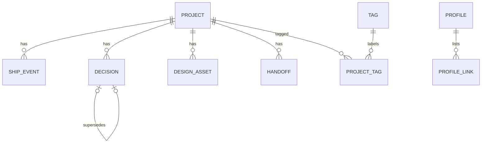

# Data architecture

## Layers
| Layer | Holds | Written by | Read by |
|---|---|---|---|
| raw | Not used. Every write comes from the user's own confirmed entries through the skill or `sp`; there is no third-party ingest. | none | none |
| clean | One file per row (GitHub) or one database row (Notion), typed frontmatter or typed properties, written once at log time | Skill log modes, `sp log`, `sp init` | Index builder (GitHub), Notion queries |
| serve | GitHub: generated files under `index/`, one per screen, pre-sorted and paged. Notion: one filtered, sorted query per screen. | `sp index` (locally and in the store Action) | Screens via read models |

The SQL below is the logical contract (ADR-0003). It is never deployed. Each backend adapter maps it exactly as the physical layout tables say, and `sp check` validates a store against it.

## Entities
| Entity | Definition (one sentence) | Owner | Access patterns |
|---|---|---|---|
| profile | Who the store owner is for work: name, headline, location, voice | Skill setup and profile modes | read whole at every boot |
| preference | One working rule Claude follows, optionally limited to one surface | Skill rules mode | active rules for a surface at boot |
| project | Anything the owner works on: product, client site, concept, skill, tool | Skill log mode, `sp log` | active by updated_at desc; by slug; by repo_url; by tag; shipped by latest ship |
| ship_event | A dated, provable thing that happened on a project (shipped, deployed, milestone, metric) | Skill log mode, `sp log` | by project and occurred_at desc; latest per project for proof |
| decision | A settled choice on a project with its reason | Skill decision mode | by project and decided_at desc |
| design_asset | Where a project's design system, screens or Design handoff live | Skill design mode, `sp log design` | by project and kind |
| handoff | A brief left on one surface for another surface to pick up | Skill handoff mode, `/sp handoff` | open by to_surface and project, created_at desc |

Supporting tables: store_meta (backend and schema version), profile_link (profile links), tag and project_tag (filterable tags), index_build (state of each GitHub index rebuild), and eight lookup tables.

## Relationships
| Entity A | Cardinality | Entity B | Notes |
|---|---|---|---|
| project | 1 to many | ship_event | Events never move between projects |
| project | 1 to many | decision | |
| project | 1 to many | design_asset | |
| project | 1 to many | handoff | Every handoff names a project; general handoffs use the reserved project slug `general` |
| project | many to many | tag | Join entity project_tag |
| decision | 0..1 to 1 | decision | superseded_by_id points from old to new |
| profile | 1 to many | profile_link | |



## Schema

```sql
-- Lookups
CREATE TABLE backend         (id smallint PRIMARY KEY, code text NOT NULL UNIQUE);
CREATE TABLE surface         (id smallint PRIMARY KEY, code text NOT NULL UNIQUE);
CREATE TABLE project_status  (id smallint PRIMARY KEY, code text NOT NULL UNIQUE);
CREATE TABLE project_type    (id smallint PRIMARY KEY, code text NOT NULL UNIQUE);
CREATE TABLE event_kind      (id smallint PRIMARY KEY, code text NOT NULL UNIQUE);
CREATE TABLE asset_kind      (id smallint PRIMARY KEY, code text NOT NULL UNIQUE);
CREATE TABLE asset_status    (id smallint PRIMARY KEY, code text NOT NULL UNIQUE);
CREATE TABLE decision_status (id smallint PRIMARY KEY, code text NOT NULL UNIQUE);
CREATE TABLE handoff_status  (id smallint PRIMARY KEY, code text NOT NULL UNIQUE);
CREATE TABLE build_status    (id smallint PRIMARY KEY, code text NOT NULL UNIQUE);

CREATE TABLE store_meta (
  id              smallint PRIMARY KEY CHECK (id = 1),
  schema_version  text NOT NULL,
  backend_id      smallint NOT NULL REFERENCES backend(id) ON DELETE RESTRICT,
  owner_handle    text NOT NULL,
  created_at      timestamptz NOT NULL,
  updated_at      timestamptz NOT NULL
);

CREATE TABLE profile (
  id            smallint PRIMARY KEY CHECK (id = 1),
  display_name  text NOT NULL,
  headline      text NOT NULL,
  location      text,
  bio           text,
  voice         text,
  created_at    timestamptz NOT NULL,
  updated_at    timestamptz NOT NULL
);

CREATE TABLE profile_link (
  id          uuid PRIMARY KEY,
  profile_id  smallint NOT NULL REFERENCES profile(id) ON DELETE CASCADE,
  label       text NOT NULL,
  url         text NOT NULL,
  sort_order  smallint NOT NULL,
  created_at  timestamptz NOT NULL
);
CREATE INDEX profile_link_order ON profile_link (profile_id, sort_order, id);

CREATE TABLE preference (
  id          uuid PRIMARY KEY,
  rule        text NOT NULL CHECK (char_length(rule) <= 200),
  surface_id  smallint REFERENCES surface(id) ON DELETE RESTRICT,  -- NULL = every surface
  is_active   boolean NOT NULL DEFAULT true,
  created_at  timestamptz NOT NULL,
  updated_at  timestamptz NOT NULL
);
CREATE INDEX preference_active_surface ON preference (is_active, surface_id, created_at, id);

CREATE TABLE tag (
  id          uuid PRIMARY KEY,
  slug        text NOT NULL UNIQUE CHECK (slug ~ '^[a-z0-9]+(-[a-z0-9]+)*$'),
  label       text NOT NULL,
  created_at  timestamptz NOT NULL
);

CREATE TABLE project (
  id                uuid PRIMARY KEY,
  slug              text NOT NULL UNIQUE CHECK (slug ~ '^[a-z0-9]+(-[a-z0-9]+)*$'),
  name              text NOT NULL,
  status_id         smallint NOT NULL REFERENCES project_status(id) ON DELETE RESTRICT,
  type_id           smallint NOT NULL REFERENCES project_type(id) ON DELETE RESTRICT,
  one_liner         text NOT NULL CHECK (char_length(one_liner) <= 140),
  problem           text,
  role              text,
  outcome           text,
  live_url          text,
  repo_url          text,
  started_on        date,
  shipped_on        date,
  last_verified_at  timestamptz NOT NULL,
  archived_at       timestamptz,
  created_at        timestamptz NOT NULL,
  updated_at        timestamptz NOT NULL
);
CREATE INDEX project_status_updated ON project (status_id, updated_at DESC, id DESC);
CREATE INDEX project_repo ON project (repo_url);

CREATE TABLE project_tag (
  project_id  uuid NOT NULL REFERENCES project(id) ON DELETE CASCADE,
  tag_id      uuid NOT NULL REFERENCES tag(id) ON DELETE RESTRICT,
  created_at  timestamptz NOT NULL,
  PRIMARY KEY (project_id, tag_id)
);
CREATE INDEX project_tag_by_tag ON project_tag (tag_id, project_id);

CREATE TABLE ship_event (
  id            uuid PRIMARY KEY,
  project_id    uuid NOT NULL REFERENCES project(id) ON DELETE RESTRICT,
  kind_id       smallint NOT NULL REFERENCES event_kind(id) ON DELETE RESTRICT,
  surface_id    smallint NOT NULL REFERENCES surface(id) ON DELETE RESTRICT,
  summary       text NOT NULL CHECK (char_length(summary) <= 280),
  proof_url     text,
  metric_label  text,
  metric_value  numeric,
  metric_unit   text,
  occurred_at   timestamptz NOT NULL,
  created_at    timestamptz NOT NULL
);
CREATE INDEX ship_event_recent ON ship_event (occurred_at DESC, id DESC);
CREATE INDEX ship_event_project_recent ON ship_event (project_id, occurred_at DESC, id DESC);

CREATE TABLE decision (
  id                uuid PRIMARY KEY,
  project_id        uuid NOT NULL REFERENCES project(id) ON DELETE RESTRICT,
  status_id         smallint NOT NULL REFERENCES decision_status(id) ON DELETE RESTRICT,
  surface_id        smallint NOT NULL REFERENCES surface(id) ON DELETE RESTRICT,
  superseded_by_id  uuid REFERENCES decision(id) ON DELETE SET NULL,
  title             text NOT NULL CHECK (char_length(title) <= 120),
  reason            text NOT NULL,
  body              text,
  decided_at        timestamptz NOT NULL,
  created_at        timestamptz NOT NULL,
  updated_at        timestamptz NOT NULL
);
CREATE INDEX decision_project_recent ON decision (project_id, decided_at DESC, id DESC);

CREATE TABLE design_asset (
  id               uuid PRIMARY KEY,
  project_id       uuid NOT NULL REFERENCES project(id) ON DELETE RESTRICT,
  kind_id          smallint NOT NULL REFERENCES asset_kind(id) ON DELETE RESTRICT,
  status_id        smallint NOT NULL REFERENCES asset_status(id) ON DELETE RESTRICT,
  surface_id       smallint NOT NULL REFERENCES surface(id) ON DELETE RESTRICT,
  title            text NOT NULL,
  source_url       text,
  tokens_repo_url  text,
  tokens_path      text,
  created_at       timestamptz NOT NULL,
  updated_at       timestamptz NOT NULL
);
CREATE INDEX design_asset_project_kind ON design_asset (project_id, kind_id, updated_at DESC, id DESC);

CREATE TABLE handoff (
  id               uuid PRIMARY KEY,
  project_id       uuid NOT NULL REFERENCES project(id) ON DELETE RESTRICT,
  from_surface_id  smallint NOT NULL REFERENCES surface(id) ON DELETE RESTRICT,
  to_surface_id    smallint NOT NULL REFERENCES surface(id) ON DELETE RESTRICT,
  status_id        smallint NOT NULL REFERENCES handoff_status(id) ON DELETE RESTRICT,
  title            text NOT NULL CHECK (char_length(title) <= 120),
  body             text NOT NULL CHECK (char_length(body) <= 4000),
  created_at       timestamptz NOT NULL,
  picked_up_at     timestamptz,
  done_at          timestamptz
);
CREATE INDEX handoff_inbox ON handoff (to_surface_id, status_id, created_at DESC, id DESC);
CREATE INDEX handoff_project ON handoff (project_id, status_id, created_at DESC, id DESC);

CREATE TABLE index_build (
  id            uuid PRIMARY KEY,
  status_id     smallint NOT NULL REFERENCES build_status(id) ON DELETE RESTRICT,
  commit_sha    text NOT NULL,
  entry_count   integer,
  boot_chars    integer,
  error         text,
  started_at    timestamptz NOT NULL,
  finished_at   timestamptz,
  created_at    timestamptz NOT NULL
);
CREATE INDEX index_build_recent ON index_build (started_at DESC, id DESC);
```

Every foreign key declares ON DELETE. Parents are never deleted through samepage (Never do), so RESTRICT is the normal rule; CASCADE only where the child has no meaning alone (profile_link, project_tag).

## Lookup tables
| Table | Values source | Seeded by |
|---|---|---|
| backend | Fixed list: github, notion | Spec v1, `schema/lookups.json` |
| surface | Fixed list: code, chat, cowork, design | Spec v1 |
| project_status | Fixed list: idea, active, shipped, parked, archived, unknown | Spec v1 |
| project_type | Fixed list: product, client_site, concept, skill, tool, content, other | Spec v1 |
| event_kind | Fixed list: shipped, deployed, launched, milestone, metric, published | Spec v1 |
| asset_kind | Fixed list: design_system, screen_set, handoff_bundle, prototype | Spec v1 |
| asset_status | Fixed list: draft, approved, superseded | Spec v1 |
| decision_status | Fixed list: accepted, superseded, reversed | Spec v1 |
| handoff_status | Fixed list: open, picked_up, done, dropped | Spec v1 |
| build_status | Fixed list: running, succeeded, failed | Spec v1 |

Lookups are stored by `code` in files and Notion select options; ids exist only in the logical contract. Adding a value is a minor spec version and an ADR.

Agent call: project_status follows the five statuses already proven in the maintainer's Notion registry (ACTIVE, SHIPPED, PARKED, ARCHIVED, UNKNOWN) plus `idea`, lowercased.

## Physical layout: GitHub store
Rules: one row per file, YAML frontmatter holds every column, the Markdown body is display-only and never parsed (structured-data rule). Frontmatter is a flat subset: scalars, ISO dates, and inline lists `[a, b]` only (ADR-0003). Filenames use the slug or the first 8 characters of the uuid.

| Table | Path | Notes |
|---|---|---|
| store_meta | `store.md` | singleton |
| profile | `profile.md` | singleton; body may hold a longer bio for humans |
| profile_link | `profile/links/{id8}.md` | |
| preference | `rules/{id8}.md` | `surface` key absent means every surface |
| tag | `tags/{slug}.md` | created by the writer on first use |
| project | `projects/{slug}.md` | `tags: [slug, slug]` in frontmatter is the project_tag join |
| ship_event | `events/{yyyy}/{yyyy-mm-dd}-{project-slug}-{id8}.md` | append-only |
| decision | `decisions/{project-slug}/{yyyy-mm-dd}-{id8}.md` | |
| design_asset | `design/{project-slug}/{id8}.md` | pointer only; tokens live in the product repo |
| handoff | `handoffs/{id8}.md` | |
| index_build | `index/builds.md` | last 50 builds, rewritten by `sp index` |
| serve files | `index/boot/{surface}.md`, `index/project/{slug}.md`, `index/projects-{n}.md`, `index/proof-{n}.md`, `index/tags/{slug}.md`, `index/handoffs-{surface}-{n}.md`, `index/rules.md` | generated, never hand-edited; header carries build commit and time; read-models.md says which screen reads which file |

Agent call (B18), file key naming, applied by `schema/fields.json`:
- `id` is written in full as `id`. Singleton ids (`store_meta.id`, `profile.id`) and `profile_link.profile_id` are implied and not written.
- A column ending in `_id` that references a lookup table is written without `_id`, holding the lookup `code`: `status_id` is `status: active`, `to_surface_id` is `to_surface: code`.
- `project_id` is written as `project`, holding the project slug. `superseded_by_id` is written as `superseded_by`, holding the decision uuid.
- `project_tag` is the `tags: [slug, slug]` list on the project file; `project_tag.created_at` takes the project's `updated_at`.
- Columns named `body` (`decision.body`, `handoff.body`) are display-only long text and are stored as the file's Markdown body, never in frontmatter. A required body must be non-empty.
- Every other column keeps its name. An optional key may be absent or empty; both mean NULL.

Agent call (B2): setup creates the reserved project `general` (type other, status active). It holds handoffs and decisions that belong to no single project, and it is excluded from boot project lists, projects pages and proof.

Agent call (B7): `handoff.to_surface_id` may not be `design` in v1; Claude Design cannot read the store (ADR-0011). `sp check` and the skill reject it.

Agent call (B12): when a new file path already exists, the writer generates a new uuid. `sp check` fails on duplicate ids.

One row per file means two surfaces writing different entries never touch the same file, so concurrent writes do not conflict.

## Physical layout: Notion store
| Table | Notion object | Notes |
|---|---|---|
| store_meta and profile | Database "Profile", exactly one row | store fields are properties on the same row |
| profile_link | Database "Links" | relation to Profile |
| preference | Database "Rules" | `Surface` select, empty means every surface |
| project and tag, project_tag | Database "Projects" | tags are a multi-select property; tag.label = option name, tag.slug = lowercased option name. Agent call (B5): a rollup property "Last shipped" (max of Ship Events Occurred) is serve-only and outside the contract |
| ship_event | Database "Ship Events" | relation to Projects |
| decision | Database "Decisions" | relation to Projects, self-relation "Superseded by" |
| design_asset | Database "Design Assets" | relation to Projects |
| handoff | Database "Handoffs" | relation to Projects |
| index_build | not used | Notion has no index; queries are the serve layer |

All eight databases sit under one private page titled "samepage". Lookup columns are select properties with exactly the codes above.

## Tenancy and access
- One store per person; the store boundary is the access boundary.
- GitHub: private repo; readable and writable by the owner's git credentials and the owner's claude.ai GitHub connector.
- Notion: private page; readable and writable by the owner's Notion connector.
- No row-level rules are needed inside a single-owner store.

## Retention
| Table | Keep for | Then |
|---|---|---|
| every entity table | forever | archived or superseded, never deleted by samepage |
| index_build | last 50 builds | older rows dropped from `index/builds.md` on rebuild |
| serve files | until next rebuild | regenerated |

## Schema evolution
Choice: versioned
Reason: stores are long-lived files owned by users, edited by several surfaces and by hand. A version number lets `sp check` tell old stores from broken ones.

Migration rules: `store.md` carries `schema_version`. Minor versions are additive only (new optional keys, new lookup codes). A major version ships `sp migrate` that rewrites files in place on a branch and opens a PR in the user's store. Readers tolerate unknown keys. No destructive change without a major version.

## Consistency
| Boundary | Strong or eventual | Reason |
|---|---|---|
| Write from Code with `sp log` | Strong for that machine | `sp log` rebuilds the index before pushing |
| Write from chat or Cowork to a GitHub store | Eventual, 90 s target | store Action rebuilds index on push |
| Any write to a Notion store | Strong | queries read live rows |
| Two surfaces editing the same project file | Optimistic | GitHub update needs the file's current sha; on mismatch the skill re-reads, re-applies the change once, then asks the user |
